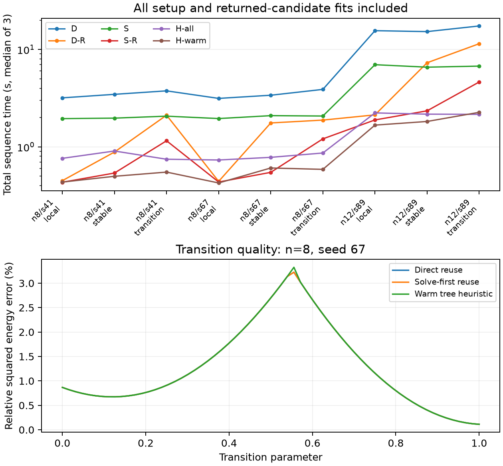

# early-ht-pde

Certify a prescribed hierarchical Tucker (HT) approximation family from a PDE
operator and forcing, before computing the full solution.

This research prototype contains **three principal experiments**, their recorded
raw data, a small Python library, and the paper draft.

[Paper](paper/draft.pdf) · [Theory](docs/THEORY.md) · [Related work](docs/RELATED_WORK.md)

## Quick start

Python 3.10+ is required. From this directory:

```bash
python -m venv .venv
source .venv/bin/activate
python -m pip install -e .
python examples/quickstart.py
```

On Windows, activate with `.venv\Scripts\activate`.
The example certifies `12|34` for a small 4D reaction–diffusion problem, reuses
the certificate for a nearby forcing, and constructs an approximation.
It needs no dataset or LaTeX installation.

## Three experiments

| Experiment | Main observation | Recorded data |
|---|---|---|
| Compression-resistant gap | Product bound = 1; the best specified scalar-plus-tail bound grows as `(3/2^(2/3) + o(1)) k^(2/3)`. Includes a Dirichlet discretization check. | [Gap](results/gap) |
| Genuine 8D HT | 14/14 non-tie cases certified among 315 balanced trees, with one HT fit per case. The tie control abstains. | [HT report](results/ht/README.md) |
| Parameter reuse | Direct reuse certifies 480/480 queries across nine sequences; six methods, three timing repetitions. | [Reuse report](results/reuse/README.md) |

The cached solve-and-round heuristic is faster in the recorded HT experiment.
For parameter reuse, solving the three forcing basis problems offline and using
the same reuse policy is also faster on every tested sequence. These studies
support certification and bound quality; they do **not** establish general
runtime superiority.



## Reproduce

```bash
python -m unittest discover -s tests -v
bash scripts/reproduce.sh smoke
# All three studies with the recorded seeds and repetition counts:
bash scripts/reproduce.sh full
```

The suite contains 151 numerical and structural tests. Smoke mode uses reduced
problem sizes; it is a functionality check, not the source of the reported
performance numbers. New runs go under `results/generated/`, which is ignored
by Git. Timing competitors run sequentially with one BLAS thread.
`requirements-recorded.txt` records the original direct dependency versions.

Regenerate the two reports from the bundled raw data without rerunning solvers:

```bash
python scripts/benchmark_ht_v3.py --report-only --output results/ht
python scripts/report_certificate_reuse.py
```

Large raw datasets are stored as `.json.gz`, without discarding queries, repeats,
or failed comparisons. Read them with Python's standard `gzip` and `json` modules:

```python
import gzip, json
with gzip.open("results/reuse/n8.json.gz", "rt") as f:
    cases = json.load(f)
```

## Scope and contents

The 8D experiment constrains every HT edge rank. The 4D reuse experiment compares
three matrix-cut families with unrestricted leaf ranks. Guarantees concern the
specified discrete families and ranks; floating-point guards are not interval
arithmetic. Certifying a family does not prove its fitted tensor globally optimal.

| Directory | Contents |
|---|---|
| `src/earlyht/` | Numerical methods and comparison baselines |
| `tests/` | Correctness checks |
| `examples/` | One runnable introduction |
| `scripts/` | Three benchmarks, gap audit, reporting, reproduction, export |
| `results/` | Only `gap`, `ht`, and `reuse` recorded studies |
| `docs/` | Theory guide and focused prior-art audit |
| `paper/` | PDF and a standalone LaTeX source ZIP |

This is an unpublished prototype developed with substantial AI assistance.
The strongest new-result candidate is the compression-resistant separation;
literature priority has not been established. The draft also discusses earlier
exploratory studies; the compact repository's reproduction commands cover the
three experiments above. [Paper sources](paper/draft_sources.zip) include the
bundled tables needed to build the draft.

Recorded configurations retain their original source hashes. Numerical library
files are unchanged by this cleanup; benchmark I/O, defaults, and report paths
were simplified. Recorded timings were not rerun or replaced.

To package this directory: `python scripts/export_repository.py`.
See [contributing](CONTRIBUTING.md) and the [MIT license](LICENSE).
